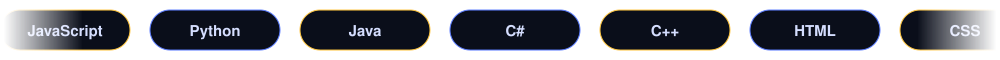

<div align="center">

<a href="https://github.com/nimeshakalanka"></a>
<a href="https://github.com/nimeshakalanka"></a>
<a href="https://nimeshakalanka.dev"></a>

</div>



## About

```bash
nimesh@stormfront:~$ whoami
Nimesh Akalanka Hettiarachchi, Full-Stack Developer & Freelancer

nimesh@stormfront:~$ cat status.json
{
  "building":  "web & software solutions, plus open-source projects",
  "exploring": ["Cloud Architecture", "DevOps", "modern backends"],
  "ask_me":    ["JavaScript", "Python", "Web Dev", "anything tech"],
  "open_to":   "collaborations & freelance work"
}

nimesh@stormfront:~$ echo $FUN_FACT
I debug with console.log and I'm not ashamed
```


## Tech Stack




## Featured Projects

<table align="center" width="100%">
  <tr>
    <td width="33%" valign="top">
      <h4><a href="https://huggingface.co/spaces/nimeshakalanka24/watermark-remover">AI Watermark Remover</a></h4>
      AI-powered tool to remove watermarks from images.<br/><br/>
      <sub><code>Python</code> <code>Hugging Face</code> <code>AI/ML</code></sub>
    </td>
    <td width="33%" valign="top">
      <h4><a href="https://github.com/nimeshakalanka/all_save">All Save Bot</a></h4>
      Telegram bot to download social media videos without watermark.<br/><br/>
      <sub><code>Python</code> <code>MongoDB</code> <code>TikTok API</code></sub>
    </td>
    <td width="33%" valign="top">
      <h4><a href="https://github.com/nimeshakalanka/nimesh-portfolio-new">Next.js Portfolio</a></h4>
      Modern portfolio built with Next.js and Tailwind CSS.<br/><br/>
      <sub><code>Next.js</code> <code>Tailwind</code> <code>Framer Motion</code></sub>
    </td>
  </tr>
  <tr>
    <td width="33%" valign="top">
      <h4><a href="https://github.com/nimeshakalanka/my-bill">Hotel Billing System</a></h4>
      Desktop app for managing hotel billing and reservations.<br/><br/>
      <sub><code>JavaScript</code> <code>Netlify</code></sub>
    </td>
    <td width="33%" valign="top">
      <h4><a href="https://github.com/nimeshakalanka/flaskProject">Flask Webcam Project</a></h4>
      Captures images from a webcam and saves them to the server.<br/><br/>
      <sub><code>Python</code> <code>Flask</code> <code>MongoDB</code></sub>
    </td>
    <td width="33%" valign="top">
      <h4><a href="https://github.com/nimeshakalanka/Priya-Dream-Kitchen.github.io">Priya Dream Kitchen</a></h4>
      Business website for a family restaurant.<br/><br/>
      <sub><code>HTML</code> <code>CSS</code> <code>JavaScript</code></sub>
    </td>
  </tr>
  <tr>
    <td width="33%" valign="top">
      <h4><a href="https://github.com/nimeshakalanka/lanka-travel-diaries">Lanka Travel Diaries</a></h4>
      Travel guide website for tourists (team project).<br/><br/>
      <sub><code>React</code> <code>SASS</code> <code>Tailwind</code></sub>
    </td>
    <td width="33%" valign="top">
      <h4><a href="https://github.com/nimeshakalanka/tiktok-api">TikTok Downloader API</a></h4>
      API for downloading TikTok videos without watermarks.<br/><br/>
      <sub><code>JavaScript</code> <code>Python</code> <code>Cloudflare</code></sub>
    </td>
    <td width="33%" valign="top">
      <h4><a href="https://github.com/nimeshakalanka/portfolio">React Portfolio</a></h4>
      Portfolio website built with React and Vite.<br/><br/>
      <sub><code>React</code> <code>Vite</code> <code>Tailwind CSS</code></sub>
    </td>
  </tr>
</table>


## GitHub Stats

<div align="center">

</div>

<details>
<summary><b>Contribution snake</b></summary>
<br/>
<div align="center">
  <picture>
    <source media="(prefers-color-scheme: dark)" srcset="https://raw.githubusercontent.com/nimeshakalanka/nimeshakalanka/output/github-contribution-grid-snake-dark.svg" />
    <source media="(prefers-color-scheme: light)" srcset="https://raw.githubusercontent.com/nimeshakalanka/nimeshakalanka/output/github-contribution-grid-snake.svg" />
    
  </picture>
</div>
</details>


## Contact

<div align="center">

<a href="https://nimeshakalanka.dev"></a>
<a href="mailto:akalankanime24@gmail.com"></a>
<a href="https://www.youtube.com/channel/UC3IrD9mIK5ZzUnYGY14ZIWQ"></a>
<a href="https://github.com/nimeshakalanka"></a>

</div>


